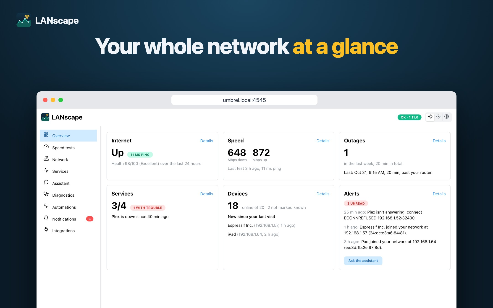
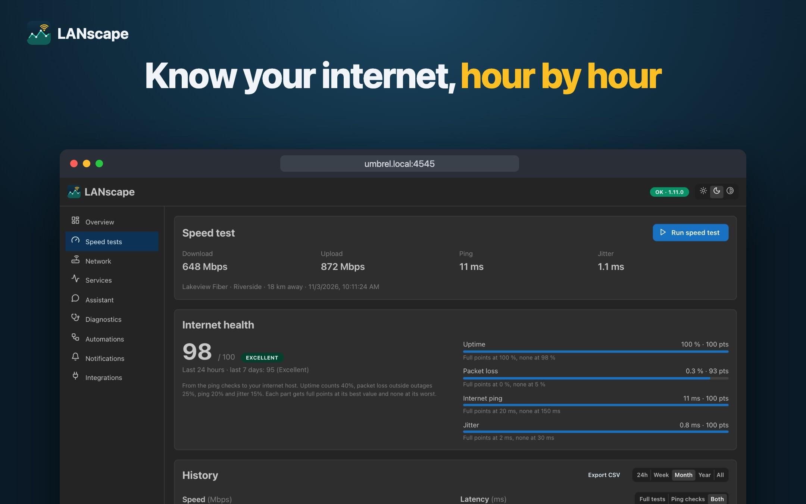
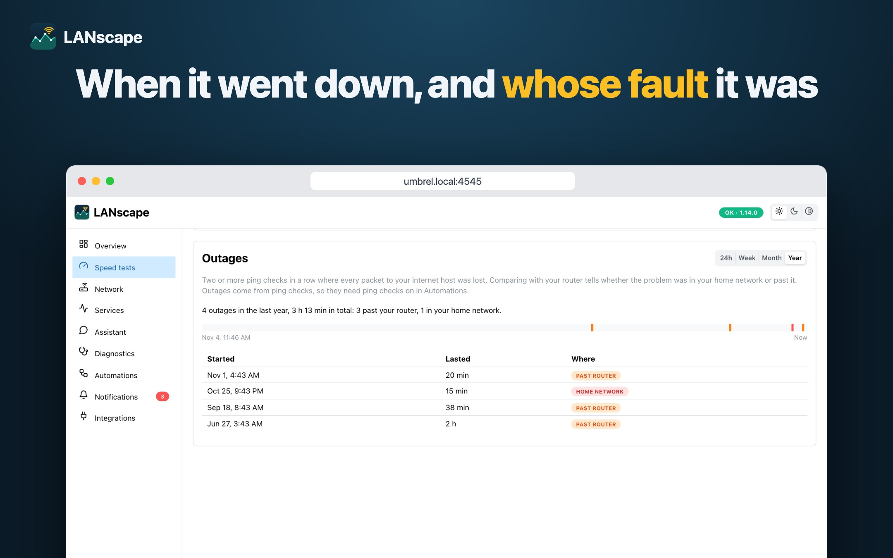
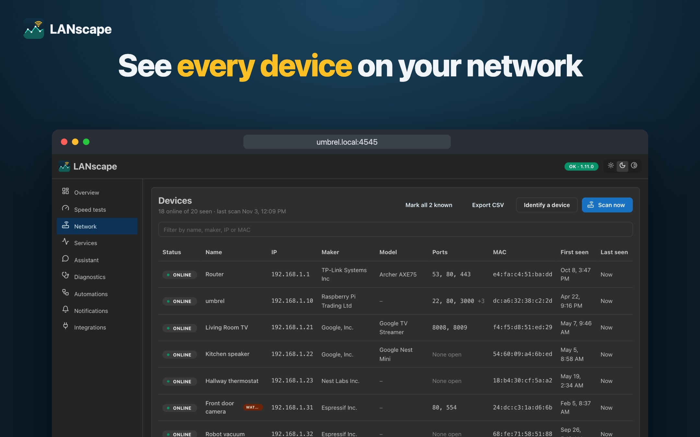
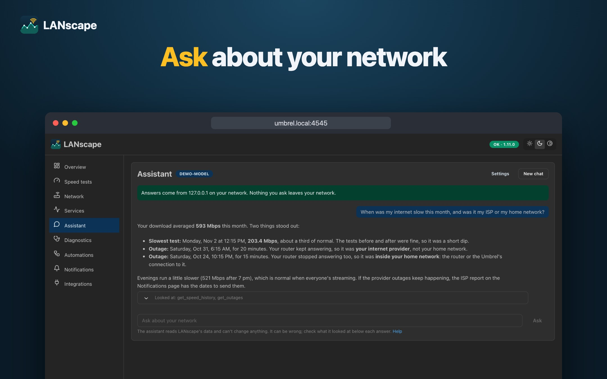
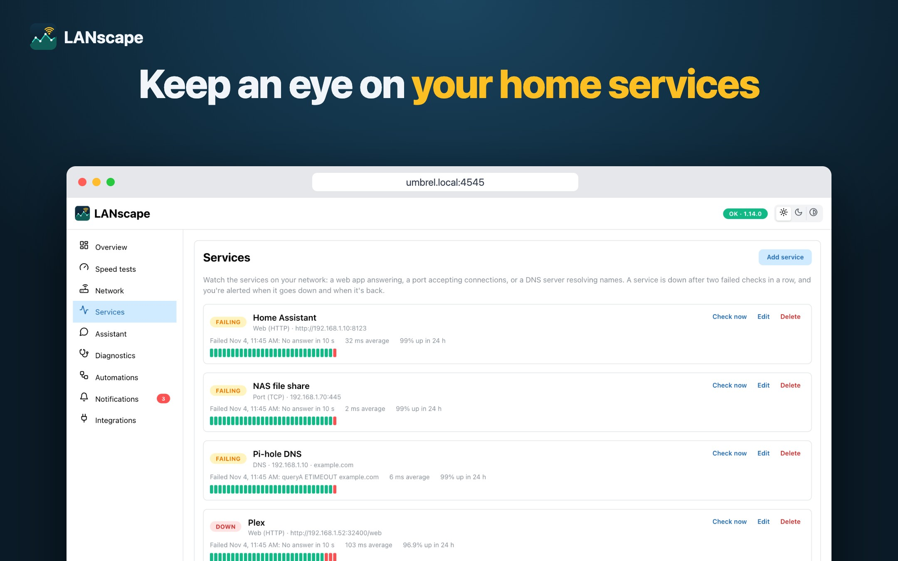
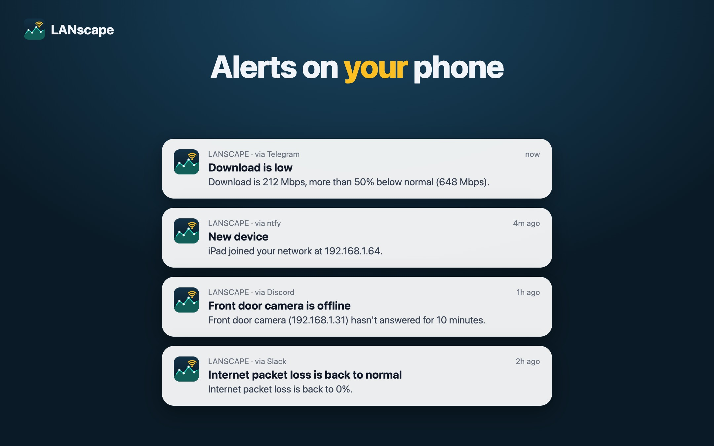

# LANscape



Home network monitoring for [Umbrel](https://umbrel.com) or any Linux machine with Docker: internet speed, latency and outages over time, every device on your network, the services you rely on, and alerts when something changes. Ask an AI assistant about it in plain language, with a model on your own network if you prefer.

Install it from an Umbrel app store: it's in the [SZ community app store](https://github.com/SuarezLuis/umbrel-apps) (add `https://github.com/SuarezLuis/umbrel-apps` under App Store → Community App Stores). Website: [lanscape.org](https://lanscape.org). Also on [AlternativeTo](https://alternativeto.net/software/lanscape/about/). User guide: [docs/HELP.md](docs/HELP.md), also on the app's Help page.

## Features

- **Overview home screen:** internet up or down, health score, latest speed, outages, services with trouble, new devices and the latest alerts at a glance.
- **Speed tests** on demand or on a schedule, with a live gauge, ping, jitter, and router and internet latency measured just before each test. History charts and a sortable table, from the last 24 hours to all time.
- **Ping checks** every minute to your router and an internet host (1.1.1.1 by default), tracking latency and packet loss with almost no data. Raw samples older than 90 days are kept as hourly averages.
- **Weekly pattern** of download, upload and ping by weekday and hour, against your plan speeds.
- **Internet Health Score** from 0 to 100, from uptime, packet loss, ping and jitter, with each part shown.
- **Outage timeline:** when the internet was down, for how long, and whether the problem was in your home network or past your router, with an alert when it's back.
- **Service checks:** watch web apps (HTTP), open ports (TCP) and DNS servers on your LAN, with alerts when they go down and come back.
- **Diagnostics:** a one-click check of router, internet, DNS, HTTPS and the route, with a plain-language verdict and a report to send your ISP.
- **Reports:** an optional weekly summary through your alert channels, and a 30-day report to send your ISP.
- **Device list** from ARP scans every 5 minutes: IP, MAC, maker (from the IEEE OUI registry), model, names announced over mDNS, UPnP and DHCP, and your own names. Includes the Umbrel itself.
- **Devices keep their identity across private MAC addresses**, matched by the stable ids they announce (Google Cast, AirPlay, HomeKit, UPnP), what they say when they join (DHCP), or their name.
- **Open ports** per device, on demand or on a schedule, with what actually answers on each one (Pi-hole, Home Assistant, Plex, OpenSSH...) next to what usually runs on that port, and an alert when a device opens a new one.
- **Identify a device** by switching it off and on between scans, or, with Pi-hole, by pausing its internet for a few minutes; plus a best guess at what each device is (camera, Roku, Android phone…) and why.
- **Per-device history and alerts:** mark devices as known, see when each came and went, and get alerted when a chosen device has been offline for a while or comes back online, like a phone arriving home. Delete a device to hear about it as new next time.
- **Notification rules** on any measurement, against a fixed value or a percentage from the 7-day median, with a "how long" window. Each rule alerts once when a problem starts and once when it clears. Also alerts when a new device joins, and optionally when an unknown one comes back.
- **Alert channels:** ntfy, Telegram (the bot answers messages with your chat ID), Discord, Slack and a generic JSON webhook.
- **Automations page** to schedule speed tests, ping checks, device scans and port scans, run any of them now, and see each job's last run and errors.
- **Choose the speed test server**, or let it pick the nearest.
- **CSV export** of speed tests, ping checks and devices.
- **Pi-hole integration:** names for devices that don't announce one, DNS activity per device, fewer sleepy devices shown as away, and pausing a device's internet to identify it.
- **AI assistant:** ask about your network in plain language, with Claude, OpenAI, or a model on your own network such as Ollama. Read-only, shows the data behind each answer, and says where your data goes.
- **MCP server for AI agents:** read-only tools for OpenClaw, Claude and other MCP clients to answer questions about your network, behind a token you can replace or turn off, with a log of their requests.
- **Backup and restore** of everything in one file, optionally encrypted with a passphrase, with a preview before restoring and an undo after.
- **Password protection:** on Umbrel it starts with the password Umbrel shows for the app; change it or sign out everywhere in Settings.
- Light, dark and system themes; works on phones.

## Screenshots

| | |
|---|---|
|  |  |
|  |  |
|  |  |

Made from invented demo data with `scripts/demo/` (seed, model, capture, gallery).

## Support

LANscape is free and open source. If it's useful to you, you can buy me a coffee:

[](https://www.buymeacoffee.com/suarezluis)

Bug reports and ideas are welcome in [issues](https://github.com/SuarezLuis/lanscape/issues).

## Stack

Node 26, npm workspaces (`server/`, `web/`), Fastify + tRPC v11, Prisma 7 + SQLite, React 19 + Vite + Mantine.

Background jobs live in `server/src/jobs/`. They shell out to `speedtest-go`, `ping`, `arp-scan` and `traceroute`, all included in the Docker image, and listen for mDNS, SSDP and DHCP on the LAN.

## Develop

```sh
npm install
npm run dev        # server on :4545, web on :5173 (forwards /trpc to the server)
npm run typecheck
npm test
npm run build
```

Locally you need `speedtest-go` on your `PATH` (or `SPEEDTEST_BIN` pointing at it) for speed tests, and `arp-scan` for device scans, which needs root. Ping checks use the system `ping`. On macOS, router detection and ARP scans need Linux, so test those on the Umbrel (see [CLAUDE.md](CLAUDE.md)).

Schema changes: edit `server/prisma/schema.prisma`, then `npm exec -w server -- prisma migrate dev --name <change>`. The container applies migrations on start.

## Run with Docker (no Umbrel)

LANscape runs on any Linux machine with Docker (amd64 or arm64), not only on Umbrel. Save this as `compose.yaml` and run `docker compose up -d`:

```yaml
services:
  lanscape:
    image: ghcr.io/suarezluis/lanscape:latest
    restart: unless-stopped
    # Device discovery (ARP scans, mDNS) needs the real network, not Docker's bridge
    network_mode: host
    # Node runs as PID 1; without an init process, stopped speed tests leave zombie processes
    init: true
    environment:
      # The password to sign in with. Without it, the first visit sets one, so set it
      APP_PASSWORD: "choose-a-long-password"
      # TZ isn't needed: schedules use the time zone you pick in the app
    volumes:
      - ./data:/data
```

Then open `http://<that machine>:4545`. Set `PORT` to use another port.

- **Linux only:** host networking, which device discovery needs, isn't available to containers on Docker Desktop for Mac or Windows. Speed tests and ping checks work there; device scans don't.
- **Permissions:** `ping` and `arp-scan` need the `NET_RAW` capability, which Docker gives containers by default. If you've dropped it (or use rootless Podman), add `cap_add: [NET_RAW]`.
- **DHCP:** LANscape listens (never answers) on UDP port 67 to recognize devices; if another DHCP server runs on the same machine, it skips that and the rest works.
- **Data:** everything is in `./data/lanscape.db`. Back it up from Settings, or copy the folder while the container is stopped.
- **Updating:** `docker compose pull && docker compose up -d`. Database migrations run on start. To stay on a version, use a tag like `ghcr.io/suarezluis/lanscape:1.10.1` instead of `latest`.
- **Forgot the password:** create an empty file named `reset-password` in `./data` (`sudo touch data/reset-password`, since Docker creates the folder as root) and restart. With `APP_PASSWORD` set it goes back to that; without it, the next visit sets a new one.

## Release

Every push to `master` publishes `ghcr.io/suarezluis/lanscape:edge`. Tag `vX.Y.Z` to publish `X.Y.Z` and `latest`, then bump the image and `version` in the app store repo.

## License

[MIT](LICENSE). Icons from [lucide-animated](https://lucide-animated.com) (MIT).
